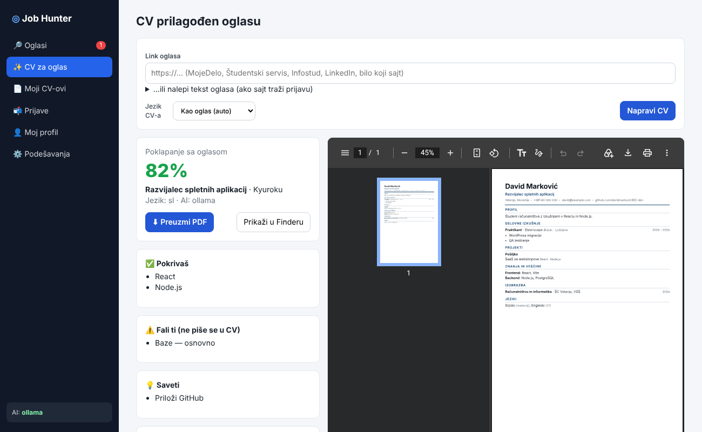
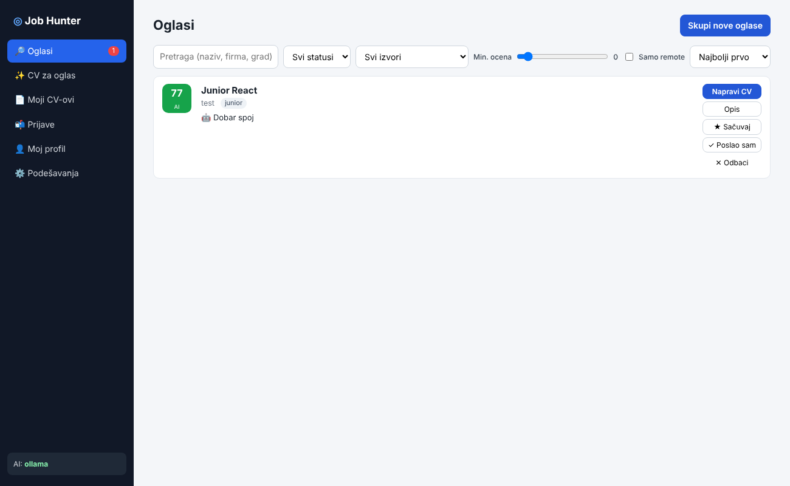

# Job Hunter

**A local job-search assistant: collects job ads from 13 sources, ranks them against your profile with an LLM, and turns any job link into a tailored, ATS-friendly PDF CV in the ad's language.**



## What it does

1. **Collects jobs** from Slovenian, Serbian and remote boards — e-Študentski servis, MojeDelo, Zaposlitev.net, Slo-Tech, Infostud, HelloWorld, LinkedIn (public listings), Remotive, RemoteOK, Arbeitnow, Jobicy, Himalayas, We Work Remotely.
2. **Filters and scores** them in two stages: a cheap keyword score (penalises *senior*, "5+ years", German-required…), then an LLM scores only the most promising ads in batches and explains each score in one sentence.
3. **Tailors the CV**: paste a job link (or the ad text) → the app extracts the ad, rewrites your CV for it in Slovenian, Serbian, English or German, and renders a one-page PDF. It also lists which requirements you cover, which you don't, and tips for the application.
4. **Tracks applications**: new → saved → sent → interview, with notes.



## Design decisions

- **Honest tailoring.** The prompt forbids inventing experience, employers, dates or skills; contact details are always copied from the profile, never from model output (enforced in code, covered by a test).
- **Structure-agnostic scraping.** Boards without an API are parsed by the *shape of job-detail URLs* plus JSON-LD `JobPosting` data, not by CSS class names, so redesigns rarely break them. Pages that need JavaScript fall back to headless Chrome.
- **Free AI with fallback.** Google Gemini (free tier) → Groq (free tier) → Ollama (fully local) → Claude (optional). Requests are throttled per provider and retried on HTTP 429; JSON output is parsed defensively.
- **Local-first.** Everything (profile, jobs, PDFs) is stored in `data/` on your machine. No account, no server.

## Stack

Node.js · Express · Cheerio · Puppeteer (rendering + PDF) · Gemini / Groq / Ollama / Claude APIs · vanilla JS front end · Mammoth & pdf-parse for CV import

```
src/
  server.js        REST API
  hunt.js          collection pipeline, keyword + AI scoring
  cv.js            CV import → profile, tailoring, HTML template, PDF
  ai.js            provider chain with throttling and fallback
  extract.js       JSON-LD + generic job-page and listing extraction
  sources/         13 job sources (HTML boards and public APIs)
public/            single-page UI
test/run.js        offline end-to-end tests (fake LLM server)
```

## Run

```bash
npm install
npm start          # http://localhost:4321
```

On macOS you can double-click `start.command`. Then add a free Gemini key in *Podešavanja* (Settings) and import your existing CV in *Moj profil*. Full guide in Serbian: [UPUTSTVO.md](UPUTSTVO.md).

## Tests

```bash
npm test
```

Runs offline: listing extraction, JSON-LD parsing, language detection, keyword scoring, CV import, tailoring and PDF rendering against a fake LLM server, and AI scoring.

---

Built by [David Marković](https://github.com/davidmarkovic952-dev).
